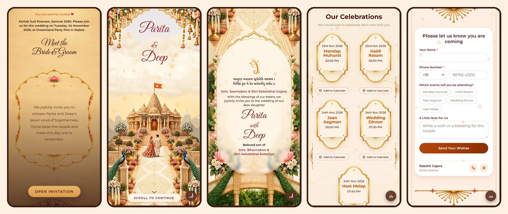

<div align="center">

# Parita & Deep

### A wedding invitation website for 23-24 November 2026, Rajkot

[](https://pariwedsdeep.pages.dev)


**[Open the invitation → pariwedsdeep.pages.dev](https://pariwedsdeep.pages.dev)**

<br>



</div>

<br>

## What it is

A guest taps the link on WhatsApp and sees a painted opening screen. When they press **Open Invitation**, the song starts and a temple scene rises into view, with the couple walking toward it. As they scroll, they get the full invitation card, a date to scratch open, all five wedding functions, the venue, an RSVP form and a countdown to the big day.

It is built for phones first, and also works on computers as a centred, phone-shaped page.

## Features

| | |
| --- | --- |
| **Opening screen** | Sand-coloured paper and a gold frame, with the words fading in one by one. |
| **Temple scene** | Layered sky, mountains, clouds and a waving flag that rise in when the invite opens. |
| **Invitation card** | A frosted card over the painting, with the shloka, both families and the couple's names. |
| **Scratch the date** | Three gold foil hearts that a finger rubs away to show the day, month and year. |
| **Five functions** | Mandap Muhurat, Haldi Rasam, Jaan Aagman, Wedding Dinner and Hast Melap, each with an **Add to Calendar** button that works on Android, iPhone and desktop. |
| **Venue** | The address, a **Get Directions** button for Google Maps, and a copy-address button. |
| **RSVP** | Replies are saved straight to a private Google Sheet, with an email for each one. If saving ever fails, the guest's WhatsApp opens with the reply already typed. |
| **Countdown** | Live days, hours, minutes and seconds to the wedding, in Indian time. |
| **Music** | A looping song with a play and pause button. It rests while the page is hidden. |
| **Share preview** | Sending the link on WhatsApp shows the couple's photo and a title. |
| **Careful details** | Falling blossoms and gold sparks, respect for "reduce motion" settings, large tap targets, and no sideways scrolling on any screen size. |

## Run it on your computer

You need [Node.js](https://nodejs.org) 20 or newer.

```bash
npm install
npm run dev
```

Then open the address it prints. To try it on your phone on the same Wi-Fi, run `npm run dev -- --host` and open the "Network" address it shows.

## Change the wedding details

Everything about the wedding lives in one file: [`src/wedding.config.js`](src/wedding.config.js).

```js
export const wedding = {
  bride: 'Parita',
  groom: 'Deep',
  weddingAt: '2026-11-24T19:45:00+05:30',
  venue: { name: 'Dreamland Party Plot', map: 'https://maps.app.goo.gl/...' },
  events: [
    { name: 'Mandap Muhurat', start: '2026-11-23T14:00:00+05:30', minutes: 60 },
    // ...
  ],
  // names, parents, wording, RSVP and contact details are in here too
};
```

Change a value and the whole page follows. The function cards, scratch hearts, calendar links and countdown are all worked out from the dates, so there is nothing else to update. A function held somewhere else can carry its own `venue`.

## Save RSVPs to a Google Sheet

Replies need a small Google script. The full steps are in [`google-sheet/SETUP.md`](google-sheet/SETUP.md) and take about five minutes:

1. Make a Google Sheet and paste [`google-sheet/Code.gs`](google-sheet/Code.gs) into **Extensions → Apps Script**.
2. Deploy it as a web app that runs as you and is open to **Anyone**.
3. Paste the web app address into `rsvp.sheetUrl` in `wedding.config.js`.

Only the sheet's owner can read the replies. "Anyone" only lets the invite send replies in. Until `sheetUrl` is set, replies go through WhatsApp instead.

## Change the song

The song is `public/music/sahiba.mp3`, and it starts when a guest presses Open Invitation. To change it, add the new song to `public/music` under a new name, point `music.file` in the config at it, then commit and push. Keep it under about 5 MB so it starts quickly on phones.

> **The song has to be committed.** Every deploy is built from this repository, so a song that is only on your computer will not reach the live site. If the file is missing, the music button hides itself.

## Put it online

```bash
npm run build
npx wrangler pages deploy dist --project-name pariwedsdeep --branch main
```

`npm run build` makes a `dist` folder that any static host can serve, such as Cloudflare Pages, Netlify or Vercel. Set the final web address in [`.env`](.env) as `VITE_SITE_URL` before building, because WhatsApp needs it to show the share picture.

## Tests

```bash
npm test
```

These check the dates and their endings, the countdown, the calendar links and files, and the RSVP rules and messages.

## How the code is organised

```
src/
├── wedding.config.js     All the wedding details
├── App.jsx               The order of the sections
├── components/           One component and stylesheet for each section
│   ├── OpeningVeil       The first screen
│   ├── HeroScene         Temple scene and names
│   ├── BlessingCard      The invitation card
│   ├── ScratchDate       The scratch-to-reveal hearts
│   ├── Celebrations      The five function cards
│   ├── VenueCard         Address and directions
│   ├── RsvpForm          Reply form
│   └── Countdown         Live countdown
├── hooks/                Music playback and copy-to-clipboard
├── lib/                  Dates, calendar and WhatsApp links, falling blossoms
└── assets/               The painted artwork
google-sheet/             The script that saves RSVPs, and its setup guide
tests/                    Unit tests
```

All sizes in the styles are written in pixels measured on a 400 px wide phone and scaled to the real screen width, so the page keeps the same proportions on every device.

## Credits

Built with [React](https://react.dev) and [Vite](https://vite.dev). The invitation's painted artwork is used with the permission of its creators; please ask them before reusing it elsewhere.

<div align="center">

<br>

Made with love for Parita and Deep ❤

</div>
